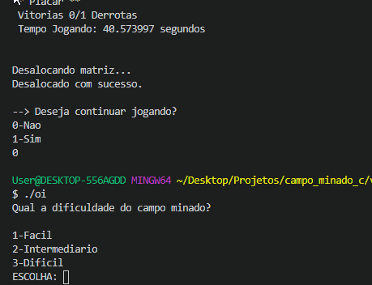
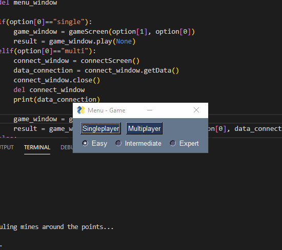

# :bomb: Minesweeper

Campo Minado em **três versões**, feitas em linguagens diferentes: terminal em
C, interface gráfica em C++/Qt e interface gráfica em Python (com modo
multiplayer).

## :speaker: Sobre o jogo

O jogador escolhe coordenadas que acredita **não** ter minas para ir limpando o
campo. Dá para marcar uma bandeira em qualquer posição para lembrar onde
provavelmente há uma bomba. Se limpar todo o campo sem abrir uma mina, você
vence; se abrir uma mina, perde.

Cada posição aberta mostra um **número** com a quantidade de minas vizinhas.

| Símbolo | Significado |
| :---: | --- |
| `#` | posição ainda não aberta |
| número | quantas minas há ao redor |
| `*` | mina (aparecem quando você perde) |
| `B` | bandeira colocada pelo jogador |

---

## :video_game: As três versões

| Versão | Linguagem | Interface | Modos |
| --- | --- | --- | --- |
| **v1_without_GUI** | C | Terminal (texto) | 1 jogador |
| **v2_with_GUI** | C++ / Qt | Janela gráfica | 1 jogador |
| **v3_py_GUI** | Python | Janela gráfica | 1 jogador e multiplayer |

Resumo visual:

- **v1** roda no **terminal/CMD**: o campo é desenhado com caracteres (`#`,
  números, `*`, `B`) e você joga digitando as coordenadas.
- **v2** é uma **janela de verdade** (feita no Qt): o campo vira uma grade de
  botões em que você clica. Configurada e executada pelo Qt Creator.
- **v3** também é uma **janela** (feita com PySimpleGUI), parecida com a v2, mas
  em Python e com a vantagem de ter **multiplayer** pela rede.

---

## :green_book: v1 — C (terminal)

Só precisa de um compilador C (GCC). No terminal, dentro de `v1_without_GUI/`:

```sh
# Linux / macOS (o -lm liga a biblioteca math)
gcc main.c -o minesweeper -lm
./minesweeper

# Windows (MinGW)
gcc main.c -o minesweeper.exe
minesweeper.exe
```

Ao rodar, você escolhe a dificuldade (tamanho do campo e número de minas) e o
jogo começa. Joga digitando as coordenadas; o placar de vitórias/derrotas e o
tempo aparecem ao final de cada partida.



---

## :green_book: v2 — C++ / Qt (interface gráfica)

Feita com **Qt** (desenvolvida no Qt Creator, Qt 5.9.9). Precisa do Qt
instalado.

**Pelo Qt Creator (mais simples):**
1. Abra o arquivo `v2_with_GUI/Minesweeper.pro` no Qt Creator.
2. Clique em **Run** (▶).
3. Na janela, vá na aba **Menu** para configurar a partida e depois em
   **Singleplayer** para jogar.

**Pela linha de comando (qmake):**
```sh
cd v2_with_GUI
qmake
make          # Windows com MSVC: nmake
./Minesweeper # abre a janela
```


> Observação do autor na época: houve dificuldades com o Qt Creator, e por isso
> a versão seguinte foi refeita em Python (v3).

---

## :green_book: v3 — Python (interface gráfica, com multiplayer)

Feita em Python com **PySimpleGUI**. Dentro de `v3_py_GUI/`:

```sh
pip install PySimpleGUI
python main.py
```

Controles:
- **Clique direito**: abre uma posição (aparece o número ou a mina).
- **Clique esquerdo**: coloca/retira uma bandeira (`B`).

Você escolhe o modo e a dificuldade ao iniciar.

### :family: Multiplayer

Um jogador **cria** a partida com o próprio IP e o outro **se conecta** a esse
IP (comunicação por socket, porta `1510`). Como os dois mexem no mesmo campo, se
o outro jogador fizer uma jogada, clique em **Update** para atualizar a tela.



> **Sobre o PySimpleGUI:** a biblioteca passou a ser paga depois que este
> projeto foi feito, e as versões antigas saíram do PyPI. Para rodar hoje, use
> a versão atual do PySimpleGUI (tem um tier gratuito com cadastro) ou instale o
> fork livre **FreeSimpleGUI** (`pip install FreeSimpleGUI`) e troque, nos
> arquivos `.py`, a linha `import PySimpleGUI as sg` por
> `import FreeSimpleGUI as sg`.

---

**:v: Bom jogo, e não fique triste se perder — Campo Minado às vezes é difícil (quando cai num problema de decisão).**
**:smiley: Boa sorte!**
